<p align="center">
  
</p>

<p align="center">
  <a href="https://github.com/ishandutta2007/Awesome-Awesome-Awesome"></a>
  <a href="https://discord.gg/jc4xtF58Ve"></a>
  <a href="https://github.com/ishandutta2007/Awesome-Enterprise-AI-Toolkits/stargazers"></a>
  <a href="https://github.com/ishandutta2007/Awesome-Enterprise-AI-Toolkits/network/members"></a>
  <a href="https://github.com/ishandutta2007/Awesome-Enterprise-AI-Toolkits/blob/main/LICENSE"></a>
  <a href="https://github.com/ishandutta2007/Awesome-Enterprise-AI-Toolkits/pulls"></a>
  <a href="https://github.com/ishandutta2007"></a>
</p>

---

# 🌟 Awesome Enterprise AI Toolkits

> **A curated landscape of production-grade Enterprise AI Toolkits, SaaS LLM Platforms, RAG Infrastructure, LLMOps, Model Serving Engines, and Autonomous Agent Orchestration Frameworks.**

Enterprise AI toolkits enable organizations to build, deploy, benchmark, and govern mission-critical AI applications at enterprise scale. They supply foundational infrastructure for **Retrieval-Augmented Generation (RAG)**, **Multi-Agent Orchestration**, **High-Throughput Model Serving**, **Unified AI Gateways**, **Observability & Tracing**, and **Compliance & Safety Guardrails** required by regulated businesses.

---

## 📑 Table of Contents

- [🌐 Sector Overview & Market Dynamics](#-sector-overview--market-dynamics)
- [🏢 Enterprise SaaS & Hosted AI Platforms](#-enterprise-saas--hosted-ai-platforms)
- [💻 Open-Source Enterprise AI Frameworks](#-open-source-enterprise-ai-frameworks)
- [🏗️ Enterprise AI Architectural Blueprint](#️-enterprise-ai-architectural-blueprint)
- [🤝 How to Contribute](#-how-to-contribute)
- [💖 Support & Sponsorship](#-support--sponsorship)
- [📈 Star History](#--star-history)
- [⚖️ Disclaimer & Compliance](#️-disclaimer--compliance)

---

## 🌐 Sector Overview & Market Dynamics

The global **Enterprise AI Platforms & Toolkits Market** was valued at approximately **$28.5 Billion in 2024** and is projected to expand at a compound annual growth rate (CAGR) of **~37.4% to exceed $195 Billion by 2030**, accelerated by enterprise migration from experimental GenAI proofs-of-concept to mission-critical multi-agent workflows and real-time private RAG systems.

### 📊 Market Concentration & Fragmentation Dynamics
- **Hyperscaler Layer (Moderately Concentrated / Oligopolistic):** The foundation model serving and compute layer is **moderately concentrated** among the top hyperscalers (**Microsoft Azure, Google Cloud, AWS**) and unified data lakehouses (**Databricks**). High capital expenditure requirements for GPU clusters, compliance certifications (SOC2, HIPAA, FedRAMP), and data gravity create steep switching moats.
- **Tooling, LLMOps & Orchestration Layer (Highly Fragmented):** Conversely, the application orchestration, prompt evaluation, enterprise vector search, and AI gateway segments remain **highly fragmented**. Enterprises actively combine best-of-breed open-source frameworks (such as **Dify, vLLM, LiteLLM, and LangGraph**) with commercial tooling to safeguard against single-vendor lock-in, preserve proprietary data sovereignty, and maintain multi-cloud portability.

---

## 🏢 Enterprise SaaS & Hosted AI Platforms

The following table benchmarks leading enterprise AI SaaS platforms. Products are **sorted descending by company size (Valuation / Market Capitalization)**.

| 🏢 Platform / Vendor | 💰 Company Size (Valuation / Revenue) | 🏷️ Starting Pricing | 🎁 Free Tier / Trial Limit | 🎯 Core Enterprise Focus & Capabilities |
| :--- | :--- | :--- | :--- | :--- |
| **[Azure AI Studio](https://azure.microsoft.com/en-us/products/ai-studio/)** <br>*(Microsoft)* | **$3.1 Trillion Market Cap** <br>(~$245B Annual Revenue) | **$0.15 / 1M input & $0.60 / 1M output tokens** (GPT-4o mini); Compute VM endpoints from **$0.041/hr** (`B1s`) | **$200 free credit for 30 days**; 55+ services free for 12 months; permanent **F0 Free Tier** (1 Azure AI Search instance w/ 50MB storage & 3 indexes, 5,000 transactions/mo on Cognitive APIs) | Unified studio for enterprise OpenAI & open models, prompt flow orchestration, RAG evaluation, Content Safety guardrails, and automated enterprise compliance. |
| **[Google Vertex AI](https://cloud.google.com/vertex-ai)** <br>*(Alphabet / Google)* | **$2.1 Trillion Market Cap** <br>(~$307B Annual Revenue) | **$0.075 / 1M input & $0.30 / 1M output tokens** (Gemini 1.5 Flash); Custom node compute from **$0.04/vCPU-hr** | **$300 free credits for 90 days** for new Google Cloud accounts; perpetual **Google AI Studio Free Tier** (15 RPM / 1M TPM); baseline free vCPU-second runtime allowances | Enterprise Gemini model ecosystem, Vertex AI Agent Builder, enterprise Datastore grounding, Model Garden (150+ foundation models), BigQuery ML integration. |
| **[AWS SageMaker](https://aws.amazon.com/sagemaker/)** <br>*(Amazon)* | **$1.9 Trillion Market Cap** <br>(~$575B Annual Revenue) | **$0.05 / hour** (`ml.t3.medium` instances); Serverless Inference from **$0.00002 / second** ($0.072/hr compute equivalent) | **AWS Free Tier (First 2 Months):** **250 hours/month** of `ml.t3.medium` notebooks; **160 session-hours/month** of SageMaker Canvas; permanent **4,000 API calls/mo** & 20MB metadata storage on SageMaker Catalog | End-to-end MLOps lifecycle, SageMaker JumpStart enterprise model hub, SageMaker Canvas no-code predictive/GenAI UI, Clarify bias detection, and Model Monitor. |
| **[IBM watsonx.ai](https://www.ibm.com/products/watsonx-ai)** <br>*(IBM)* | **$210 Billion Market Cap** <br>(~$62B Annual Revenue) | **$0.60 / 1M input & $1.80 / 1M output tokens** (Granite models on Essentials pay-as-you-go); Standard Plan platform fee from **$1,050 / month** (includes 500 CUH) | **watsonx.ai Lite Plan (Free forever):** **300,000 tokens/month** in foundation model playground; **10–20 Compute Usage Hours (CUH)/mo** for ML tools; **100 document extractions/mo** | Rigorous governance and auditability (watsonx.governance), Granite enterprise foundation models, prompt tuning studio, and hybrid-cloud Red Hat OpenShift integration. |
| **[Databricks Mosaic AI](https://www.databricks.com/product/machine-learning)** <br>*(Databricks)* | **$43 Billion Valuation** <br>(~$1.6B+ ARR) | **$0.07 / DBU** (Databricks Units) for Serverless Model Serving; Standard data compute from **$0.15 / DBU** | **14-day commercial Free Trial with $400 credits**; permanent **Databricks Free Edition** (1 AI Search unit, non-GPU, max 3 serverless apps with 24-hr runtime) | Unity Catalog centralized data & AI governance, Mosaic AI Vector Search, Model Serving, custom fine-tuning, and Agent Bricks native to data lakehouses. |
| **[Scale AI (GenAI Platform)](https://scale.com/)** <br>*(Scale AI)* | **$13.8 Billion Valuation** <br>(~$300M+ ARR) | Custom enterprise annual contracts starting at **~$50,000 / year** (~$4,166/month); historical Nucleus Team plans started at **$500 / month** | **Guided Enterprise POC / Trial (typically 14–30 days)** via sales demo; legacy Nucleus tier offered up to **10,000 free dataset labeling items** | Enterprise RLHF data engine, Model Evaluation & Red Teaming, Scale Donovan platform for mission-critical and defense deployments, custom model fine-tuning. |
| **[DataRobot Platform](https://www.datarobot.com/)** <br>*(DataRobot)* | **$6.3 Billion Valuation** <br>(~$200M+ ARR) | Annual enterprise commitments starting at **~$25,000 / year** (~$2,083/month billed annually) | **30-day Free Trial (Self-Service SaaS):** Full AutoML access, shared modeling workers, up to **15 vector databases**, and **1,000 LLM calls** | Unified predictive & generative AI platform, LLM evaluation suite, customizable guardrail templates, automated vector store provisioning, and enterprise MLOps. |
| **[Cohere (Enterprise Platform)](https://cohere.com/)** <br>*(Cohere)* | **$5.5 Billion Valuation** <br>(~$50M+ ARR) | **$0.15 / 1M input & $0.60 / 1M output tokens** (Command R); Embed v3 at **$0.10 / 1M tokens**; Rerank at **$2.00 / 1K searches** | **Trial API Key (Free forever for non-commercial evaluation):** Capped at **1,000 API calls/month** across all endpoints, 20 RPM Chat, 100 RPM Embed/Rerank | Enterprise-first RAG with verifiable citations, industry-standard reranking models, private VPC and on-premises air-gapped deployments across AWS Bedrock, GCP, and Azure. |
| **[Dataiku DSS](https://www.dataiku.com/)** <br>*(Dataiku)* | **$3.7 Billion Valuation** <br>(~$150M+ ARR) | Commercial Discover / Business plans start at **~$4,000 / month** ($48,000/year billed annually) | **Free Edition (Free forever, self-hosted):** Up to **3 users** on local/on-prem infrastructure; OR **14-day Cloud Trial** with 4 vCPUs, 32 GiB RAM, and 1 API service | LLM Mesh multi-model gateway, visual data pipelines + code workflows, automated ML, enterprise governance and compliance catalog. |
| **[Domino Data Lab](https://www.domino.ai/)** <br>*(Domino)* | **$1.5 Billion Valuation** <br>(~$50M+ ARR) | Commercial licenses start at **$3,500 / user / year** (~$291/user/mo, min. 5 seats = **$17,500/year base**) | **14-day trial via NVIDIA LaunchPad:** Includes up to **$20,000 in accelerated compute (GPU/CPU)** infrastructure; custom corporate POCs upon request | Kubernetes-native multi-cloud compute orchestration, model registry, reproducible experiment tracking, and Domino Code Assist. |

---

## 💻 Open-Source Enterprise AI Frameworks

Leading open-source projects for self-hosting, vendor-agnostic infrastructure, and auditable enterprise deployments. Projects are **sorted descending by GitHub stargazers count**.

| 📦 Repository & Stargazers Badge | 🏷️ Category | 📜 License | 🎯 Best Enterprise Use Case |
| :--- | :--- | :--- | :--- |
| **[Dify](https://github.com/langgenius/dify)** <br>[](https://github.com/langgenius/dify/stargazers) | Visual Workflow & GenAI App Platform | Apache 2.0 | Teams needing a production-ready, low-code platform combining visual prompt engineering, RAG pipelines, agent workflows, and API publishing. |
| **[Open WebUI](https://github.com/open-webui/open-webui)** <br>[](https://github.com/open-webui/open-webui/stargazers) | Enterprise AI Workspace & UI | Open WebUI | Organizations requiring an enterprise-ready, self-hosted ChatGPT-like interface with native RAG, granular Role-Based Access Control (RBAC), and Ollama/OpenAI API backend support. |
| **[vLLM](https://github.com/vllm-project/vllm)** <br>[](https://github.com/vllm-project/vllm/stargazers) | High-Throughput Model Serving Engine | Apache 2.0 | Serving open-source LLMs (Llama 3, Mistral, Qwen) with PagedAttention, continuous batching, and high-throughput low-latency inference at minimum GPU cost. |
| **[RAGFlow](https://github.com/infiniflow/ragflow)** <br>[](https://github.com/infiniflow/ragflow/stargazers) | Deep Document Understanding RAG Engine | Apache 2.0 | Enterprises with complex, unstructured corporate documents (PDFs, PPTs, tables, scanned images) requiring high-precision OCR and citation grounding. |
| **[LiteLLM](https://github.com/BerriAI/litellm)** <br>[](https://github.com/BerriAI/litellm/stargazers) | Universal LLM Proxy & Gateway | MIT | Centralized enterprise AI gateway supporting 100+ LLMs with unified OpenAI format, load balancing, fallback routing, and team spend tracking. |
| **[Flowise](https://github.com/FlowiseAI/Flowise)** <br>[](https://github.com/FlowiseAI/Flowise/stargazers) | Low-Code UI for LLMs & Agents | MIT | Rapid prototyping and deployment of LangChain/LlamaIndex agents and conversational flows via drag-and-drop node graph canvas. |
| **[LlamaIndex](https://github.com/run-llama/llama_index)** <br>[](https://github.com/run-llama/llama_index/stargazers) | Enterprise Data Framework for RAG | MIT | Connecting private enterprise data stores (SQL, Notion, S3, Slack) to LLMs with advanced indexing, hybrid search, and query transformation engines. |
| **[LocalAI](https://github.com/mudler/LocalAI)** <br>[](https://github.com/mudler/LocalAI/stargazers) | Self-Hosted Multi-Modal Serving | MIT | Air-gapped, privacy-first enterprise environments requiring OpenAI-compatible REST APIs for text, audio, and vision running on consumer or enterprise CPU/GPU hardware. |
| **[LangGraph](https://github.com/langchain-ai/langgraph)** <br>[](https://github.com/langchain-ai/langgraph/stargazers) | Multi-Agent Graph Orchestration | MIT | Production-grade stateful agent orchestration featuring persistent checkpointing, human-in-the-loop approvals, cyclical graphs, and time-travel debugging. |
| **[Semantic Kernel](https://github.com/microsoft/semantic-kernel)** <br>[](https://github.com/microsoft/semantic-kernel/stargazers) | Enterprise SDK (.NET, Python, Java) | MIT | Enterprise organizations standardized on Microsoft Azure, C#/.NET, and enterprise security integrating AI plugins, memories, and planners into existing codebases. |
| **[Bisheng](https://github.com/dataelement/bisheng)** <br>[](https://github.com/dataelement/bisheng/stargazers) | Enterprise LLM DevOps & Workflow | Apache 2.0 | Comprehensive enterprise LLM platform offering visual workflow builders, knowledge base parsing, fine-tuning datasets, and model lifecycle orchestration. |
| **[Phoenix (Arize AI)](https://github.com/Arize-ai/phoenix)** <br>[](https://github.com/Arize-ai/phoenix/stargazers) | LLM Observability & Evaluation | Apache 2.0 | OpenTelemetry-native tracing, RAG performance benchmarking, LLM-as-a-judge evaluation, and embedding drift analysis for production monitoring. |
| **[Xinference](https://github.com/xorbitsai/inference)** <br>[](https://github.com/xorbitsai/inference/stargazers) | Distributed Model Inference Engine | Apache 2.0 | Scalable cluster serving for open-source LLMs, embedding, and multimodal models with distributed worker scheduling and high throughput. |
| **[Bifrost (Maxim AI)](https://github.com/maximhq/bifrost)** <br>[](https://github.com/maximhq/bifrost/stargazers) | High-Performance Enterprise Gateway | Apache 2.0 | Ultra-low-latency AI gateway (sub-100μs overhead) supporting 1,000+ models with adaptive load balancing, OAuth 2.0 RBAC, and prompt injection defense. |
| **[Agenta](https://github.com/Agenta-AI/agenta)** <br>[](https://github.com/Agenta-AI/agenta/stargazers) | Open-Source LLMOps Platform | Apache 2.0 | Rigorous prompt management, human-in-the-loop evaluation, LLM-as-judge scoring, and OpenTelemetry observability for engineering teams. |
| **[Pezzo](https://github.com/pezzolabs/pezzo)** <br>[](https://github.com/pezzolabs/pezzo/stargazers) | Cloud-Native LLMOps Platform | Apache 2.0 | Developer-centric prompt design, instant version deployments, semantic caching, and real-time execution analytics backed by ClickHouse and PostgreSQL. |
| **[Cohere Toolkit](https://github.com/cohere-ai/cohere-toolkit)** <br>[](https://github.com/cohere-ai/cohere-toolkit/stargazers) | Enterprise RAG Reference Stack | MIT | Modular, containerized RAG template featuring a Next.js web application, multi-connector data ingestion, and hybrid retrieval. *(Archived upstream reference)*. |
| **[Gebo.ai](https://github.com/geboai/Gebo.ai)** <br>[](https://github.com/geboai/Gebo.ai/stargazers) | Vendor-Agnostic Enterprise RAG | Apache 2.0 | Turnkey single-container enterprise platform connecting SharePoint, Confluence, Jira, and S3 with SSO, multi-user isolation, and Model Context Protocol (MCP). |

### 🛠️ Additional Specialized Open-Source Components
- 🔒 **[TencentCloud Octop](https://github.com/TencentCloud/Octop)** — Self-hosted enterprise AI workspace with local task execution on client devices and centralized administrative governance.
- 🛡️ **[Harnis](https://github.com/harnis-ai/harnis)** — Multi-tenant agent harness with OIDC Single Sign-On, sandboxed code execution, and mandatory human approvals.
- ⚡ **[AIForge](https://github.com/zsh-aiforge/aiforge)** — Lightweight, protocol-driven Python framework for agents, workflows, RAG, and RBAC built solely on Pydantic.

---

## 🏗️ Enterprise AI Architectural Blueprint

Modern enterprise AI platforms typically implement a layered, modular architecture to maximize resilience, governance, and cost efficiency:

```
┌────────────────────────────────────────────────────────────────────────┐
│                        Enterprise Applications & UI                    │
│             (Open WebUI, Dify, Custom Internal Portals, Slack/Teams)   │
└───────────────────────────────────┬────────────────────────────────────┘
                                    │
┌───────────────────────────────────▼────────────────────────────────────┐
│                    Enterprise AI Gateway & Security                    │
│          (LiteLLM, Bifrost: Rate Limiting, RBAC, PII Redaction)        │
└───────────────────────────────────┬────────────────────────────────────┘
                                    │
         ┌──────────────────────────┴──────────────────────────┐
         ▼                                                     ▼
┌─────────────────────────────────┐   ┌──────────────────────────────────┐
│     Agent & Workflow Layer      │   │     RAG & Knowledge Retrieval    │
│  (LangGraph, Semantic Kernel)   │   │  (RAGFlow, LlamaIndex, Qdrant)   │
└────────────────┬────────────────┘   └────────────────┬─────────────────┘
                 │                                     │
                 └──────────────────┬──────────────────┘
                                    │
┌───────────────────────────────────▼────────────────────────────────────┐
│                  Inference, Serving & Cloud Foundation                 │
│    (vLLM, LocalAI, Azure AI Studio, Vertex AI, AWS SageMaker, Mosaic)  │
└───────────────────────────────────┬────────────────────────────────────┘
                                    │
┌───────────────────────────────────▼────────────────────────────────────┐
│                      LLMOps, Tracing & Governance                      │
│                (Phoenix Arize, Agenta, Pezzo, OpenTelemetry)           │
└────────────────────────────────────────────────────────────────────────┘
```

---

## 🤝 How to Contribute

Contributions from enterprise architects, platform engineers, and open-source maintainers are warmly welcomed! 🚀

1. 🍴 **Fork the repository** on GitHub.
2. 🌿 **Create a descriptive feature branch** (`git checkout -b feature/add-new-toolkit`).
3. 📝 **Add or update entries in `README.md`**:
   - For **SaaS**: Include verified starting pricing and exact free tier/trial limits in the tabular format.
   - For **Open-Source**: Include the official repository URL, stargazers badge (`style=social&color=white`), license, and core enterprise use case.
4. ✅ **Ensure consistent formatting, working URLs, and alphabetical / metric sorting**.
5. 🚀 **Submit a Pull Request** with a clear summary of your additions.

---

## 💖 Support & Sponsorship

Thank you for exploring and utilizing **Awesome Enterprise AI Toolkits**! If this repository has helped you or your organization navigate the enterprise AI and LLMOps landscape, please consider supporting the project:

- ⭐ **Star this repository** to help others discover it.
- 🍴 **Fork and contribute** new tools, benchmarks, and architectural patterns.
- 📢 **Share it** with fellow engineers, architects, and tech leaders on LinkedIn, X/Twitter, or Reddit.
- ☕ **Buy me a coffee / Sponsor the project**: Support continuous research and maintenance via the [GitHub Sponsors Dashboard](https://github.com/sponsors/ishandutta2007).

<p align="left">
  <a href="https://github.com/sponsors/ishandutta2007">
    
  </a>
</p>

---

##  Star History
[](https://star-history.dera.page/#ishandutta2007/Awesome-Enterprise-AI-Toolkits&type=date&legend=top-left)

---

## ⚖️ Disclaimer & Compliance

- This repository is a **community-curated index** created for educational, architectural, and benchmarking purposes. It does not constitute commercial endorsement or investment advice.
- Pricing, free tier limits, and feature sets change regularly. Always confirm details directly with official platform documentation and vendors before procurement.
- Organizations deploying generative AI must verify compliance with local regulatory frameworks (e.g., EU AI Act, GDPR, HIPAA, SOC 2 Type II).

---

<p align="center">
  <b>Built with ❤️ for enterprise architects, MLOps teams, and AI engineers worldwide.</b><br>
  <sub>Star ⭐ this repository if it helps you design resilient, governable enterprise AI systems!</sub>
</p>
